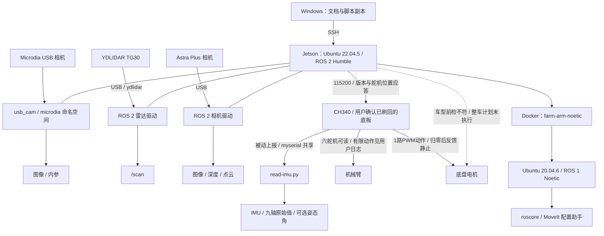

# 架构与代码地图

更新：2026-10-20｜适用：本项目本地资料、Jetson 宿主机与 Noetic 教程容器。
依据：[单舵机记录](reports/2026-10-18-arm-servo-test.md)、[底盘局部实测](reports/2026-10-19-motor-test.md)、[用户整车前检日志](reports/2026-10-19-motion-demo-preflight.md)和[安装库源码清单](reports/2026-10-19-rosmaster-api-inventory.json)。arm-check.py 首次部署和 motor-check.py 有哈希核对；arm.py、motion-demo.py 及传感器三个脚本的设备哈希待核对。传感器依据另见[源码/接口指纹](reports/2026-10-20-sensor-api-inventory.json)、[用户运行与复查](reports/2026-10-20-sensors-startup.md)。

## 1. 系统边界

实线仅表示已记录的连接或软件关系，不代表此刻正在运行。虚线部分未完成控制验收。Noetic 教程容器使用 `network none`，未映射硬件控制设备；目前无已验证的 ROS 1／ROS 2 桥接链路。X11 只负责显示，不建立机器人控制通路。

系统与接线参数以[硬件环境](environment/hardware.md)与[软件环境](environment/software.md)为主；教程容器以[机械臂专题](guides/arm.md)为主。

## 2. 本地与设备代码定位

本地设备相关实现包括教程容器脚本和有限范围的串口测试脚本，此外保存文档、资料原件和文档维护工具；没有已归档的整套机器人源码或自定义固件。以下远端路径除明确注明本次核对外，均需在开发时复核。

| 位置 | 对象与职责 | 版本／验证状态 |
|---|---|---|
| 本地 [start-sensors.py](../modules/sensors/start-sensors.py)；用户设备 `~/start-sensors.py` | 选择 Astra/Microdia/雷达/IMU，加载环境、前检、管理进程组 | 11 项离线测试；有用户 all 启动日志，设备文件哈希/停止机制待验证；无开机自启 |
| 本地 [read-imu.py](../modules/sensors/read-imu.py)；用户设备 `~/read-imu.py` | 独占串口被动解析 0x0B/0x0E/0x0C，上报 ROS 话题，不发串口指令 | 8 项离线协议测试；用户连续计数约 24.35 Hz/校验错误 0，实值和标定未验收 |
| 本地 [read-sensors.py](../modules/sensors/read-sensors.py) | 订阅各传感器、仅缓存最新消息并打印计数/新鲜度 | 语法检查通过，无用户现场输出；不是完整数据记录器 |
| 本地 [modules/arm/arm-noetic.sh](../modules/arm/arm-noetic.sh) | 教程容器创建、启动、命令转发、停止 | 2026-10-17 阅读；未执行；当前与设备副本一致性未复核 |
| 本地 [modules/arm/arm.py](../modules/arm/arm.py)；用户在 Jetson `/home/jetson/farm-tools/arm.py` 运行 | 独立三参数 `test_motor(id, amplitude_deg, duration_ms)`：按库映射相对移动、反馈通过后返回，管理串口、不自动开启扭矩 | 2026-10-18 十项离线测试；用户提供 1～5 号八次局部往返 passed；设备哈希未读回，前次无动作根因未定位，6 号新日志待补 |
| 本地 [modules/arm/arm-check.py](../modules/arm/arm-check.py)；设备 `/home/jetson/farm-tools/arm-check.py` | 直接串口查询与显式选择的 6 号小幅往返；暂停/恢复已识别原厂程序，不开启全部扭矩 | 2026-10-18 首次部署核对 SHA-256；后续本地减 300、设备减 122，已出现差异，未覆盖/部署；现场动作通过、返回精度未通过，不是整臂驱动 |
| 本地 [modules/chassis/motor-check.py](../modules/chassis/motor-check.py)；设备 `/home/jetson/farm-tools/motor-check.py` | 默认只读；显式分路 PWM，子进程计时归零，采集编码器 | 2026-10-19 本地/设备哈希一致；1 路有动作。脚本按悬空设计，实际用户更正为地面，不能凭其他计数变化判断故障；2～4 路未独立测 |
| 本地 [modules/chassis/motion-demo.py](../modules/chassis/motion-demo.py)；用户在设备 `~/motion-demo.py` 运行 | 官方速度接口有限动作；接收会话可结束；独立 `--configure-x3plus` 持久化配置并读回，与运动互斥 | 用户已运行线程修复版，车型仍为 1、动作拒绝、该次退出正常；当前新增配置选项暂无上车结果；设备哈希未核对，四项离线回归通过 |
| [安装库源码快照](reports/2026-10-19-rosmaster-lib-source.txt)及设备 Python 3.10 egg | Rosmaster_Lib 3.3.1 的控制帧、接收解析及反馈方法 | loader 源码哈希已核对，全部 38 个公开方法见[API 清单](references/rosmaster-motion-api.md)；构造开扭矩，接口存在不等于真机通过 |
| 本地 [modules/arm/verify-moveit-sim.py](../modules/arm/verify-moveit-sim.py) | 第 1 课六项目标规划与 fake 执行验证，依赖 rospy / moveit_commander | dev 原脚本字节不变；2026-10-11 6/6 历史通过，设备文件当前一致性未复核，仅用于隔离教程容器 |
| Jetson `/home/jetson/farm-tools/arm-noetic.sh` | 上述脚本部署入口 | 2026-10-11 部署与 `core` 实测；未记录部署哈希 |
| Jetson `/home/jetson/.bashrc` | 环境加载与车型、雷达、相机变量 | 变更及备份见软件环境文档 |
| Jetson `/home/jetson/yahboomcar_ros2_ws/software/library_ws` | 原厂库工作空间；传感器依赖入口 | 2026-10-20 已定位 src/ydlidar_ros2_driver 与 src/ros2_astra_camera；前者 HEAD 已记录、后者无 Git 元数据，完整源码未归档 |
| Jetson `/home/jetson/yahboomcar_ros2_ws/yahboomcar_ws` | 原厂机器人应用工作空间 | `laser_bringup_launch.py` 的 x3plus 分支缺失；绝对文件路径待定位 |
| Jetson `/home/jetson/Rosmaster` | 原厂示例资料参考路径 | 库实际导入位置在 Python egg，不能把此目录当成当前安装源码；完整示例和提交待归档 |
| 容器 `/root/yahboomcar_ws/src/x3plus_moveit_config` | 预装 MoveIt 配置 | 2026-10-11 历史配置核对与 6/6 fake 规划执行通过；未验收真机配置 |
| 容器 `/root/yahboomcar_ws/src/yahboomcar_description/urdf/yahboomcar_X3plus.urdf` | X3 Plus 模型 | 2026-10-11 历史模型加载通过；与实物一致性未验证 |
| 容器 `/root/software/library_ws/devel/setup.bash` | ROS 1 库环境加载入口 | 本地脚本引用；依赖版本需后续归档 |
| 自定义底板固件 | 控制协议、反馈、停止与执行器控制 | 源码位置、版本、构建与烧录方法均待归档 |

教程脚本按 `mode` 分派 `start/shell/core/setup/stop`；非 `stop` 模式下，容器不存在时创建，存在时核对用途标签，再按需启动。`core` 执行 `roscore`；`setup` 执行 MoveIt 配置助手；`stop` 直接停止同名容器，位于标签检查之前。脚本不是整车驱动入口。

持久数据映射：Jetson `/home/jetson/farm-arm-data` ↔ 容器 `/root/farm_data`（按 `jetson` 用户执行时）；脚本实际源路径采用 `$HOME/farm-arm-data`。换用户执行会改变路径，不能直接照搬同一部署假设。

## 3. 已知接口与缺口

| 接口 | 生产者 → 消费者 | 已记录内容 | 编程前还需核对 |
|---|---|---|---|
| `/scan` | `ydlidar_ros2_driver` → 感知／可视化订阅端 | sensor_msgs/msg/LaserScan；SensorDataQoS、frame_id=laser；10.15 Hz 为 2026-10-11 历史值 | 本轮连续消息、时间戳语义、安装外参、精度 |
| `/camera/color/image_raw` | `astra_camera` → 图像订阅端 | Image；rgb8；640×480 | 完整类型、QoS、时间同步、相机坐标 |
| `/camera/depth/image_raw` | `astra_camera` → 深度订阅端 | Image；16UC1；640×480 | 本机源码/用户日志支持毫米单位、0 视为无效；实测测距精度、RGB 对齐与同步仍待验收 |
| `/camera/ir/image_raw` | `astra_camera` → 图像订阅端 | Image；mono8 | QoS、坐标、同步 |
| `/camera/depth/points` | `astra_camera` → 点云订阅端 | PointCloud2，收到连续消息 | fields、坐标、单位、几何精度 |
| `/microdia/image_raw`、`/microdia/camera_info` | usb_cam → 订阅端 | 本项目命名空间，Image/CameraInfo；YUYV 640×480 30 fps 是配置目标 | 实际输出编码/QoS/帧率、图像、内参与安装位置；缺标定文件不造值 |
| `/imu/data_raw`、`/imu/raw9`、`/imu/rpy` | read-imu.py → 订阅端 | Imu / Int32MultiArray / Float64MultiArray；换算、顺序、时间戳见[IMU 契约](guides/sensors.md#九轴-imu-读取) | 芯片/磁场单位/安装轴向/标定；姿态话题仅有相应报文时发布；真实字段及独立订阅待验证 |
| 各路 `camera_info` | 相机驱动 → 标定信息消费者 | CameraInfo；连续发布、内参非零 | 标定来源、畸变模型、与图像一致性 |
| `/dev/myserial` | Jetson ↔ 刷回后的底板 | 115200；版本 3.5、舵机位置、编码器；底盘 1 路 PWM 有动作。用户整车前检读回底板车型 1，预期 Plus 为 2 | 实物轮位、速度精度、车型配置成功日志、完整限位、超时与急停；不将原厂角度区间当实物限位 |
| `map → odom → base_link → 传感器` | 待确定 | 目标整车 TF 关系，尚未验证 | 各变换发布者、轴方向、单位、外参与更新频率 |

上表是带日期的记录，不是完整驱动验收。官方 Python 速度接口的实现已归档，但整车动作因底板车型前检终止，里程计/速度精度未验收。ROS 环境标识、Python 对象车型与底板持久化车型是三个不同配置，见[软件环境](environment/software.md#底板与-python-控制环境)。dev 历史核对了 Noetic 的 `TargetAngle` / `yahboomcar_msgs/ArmJoint` 链路，但当前部署、完整字段及 MoveIt 真机通信未验收。

## 4. 修改定位与验证入口

| 任务 | 先读／定位 | 最小验证范围 |
|---|---|---|
| 传感器启动问题 | 软件环境与传感器指南，对应驱动 launch 与参数文件 | 单设备启动、数据、停止；参数变化后回归 |
| Noetic 教程入口 | 本地脚本、机械臂专题、设备副本差异 | 脚本语法、容器边界、master、图形分别验证 |
| X3 Plus 整车适配 | 真实启动文件、机器人模型、底盘库及固件契约 | 配置加载、反馈、运动与停止分阶段验收 |
| 底盘协议开发 | 固件源码、协议、板卡版本先归档 | 离线编解码与异常帧，再按条件验证硬件 |

传感器局部脚本的上传、19 项离线测试、运行与停止入口见[指南](guides/sensors.md)；这不构成整车统一构建。当前无统一的本地构建／测试／部署命令可供整车代码使用；建立真实源码入口后再补充。AI 每次修改应记录本地版本与设备部署版本，未部署或未复测必须明确说明。

本地模块入口见[modules](../modules/README.md)。农场旋耕与 RTK 的[设计设想](plans/farm-workflow.md)尚未与本图的设备架构建立已确认关系。
